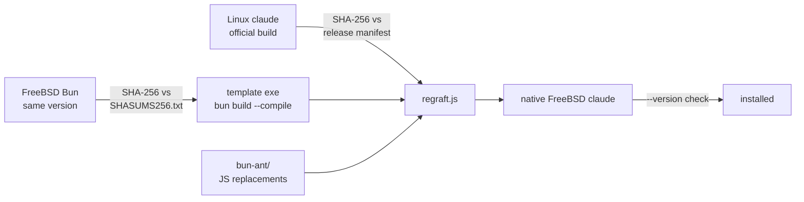

# claude-native: technical overview

This document explains how `claude-native` turns Anthropic's official
Linux build of Claude Code into a native FreeBSD executable, what it changes
and why, and how the result compares to running the Linux build under
FreeBSD's Linux binary compatibility layer (the Linuxulator).

For installation and day-to-day use, see [README.md](README.md). For the
terminal-renderer replacement in detail, see
[CELLSEGMENTER.md](CELLSEGMENTER.md).

## Summary

Claude Code ships as a [Bun](https://bun.sh) single-file executable: a
platform-specific Bun runtime with Claude Code's JavaScript embedded in it.
The JavaScript is platform-independent. Bun publishes an official FreeBSD
build of the same runtime. `claude-native` therefore takes the JavaScript
out of the Linux executable and places it, byte for byte, into an
executable built by FreeBSD Bun. A small amount of JavaScript fills the
gaps where Anthropic's runtime has features that stock Bun lacks.

The result is an ordinary FreeBSD ELF binary. It needs no kernel module, no
Linux userland, no compatibility mounts and no root access to run.
Conversion happens on the user's machine from verified official downloads;
no converted binary is ever distributed.

## Background: how Claude Code is packaged

`bun build --compile` produces an executable made of two parts:

- **The runtime:** Bun itself (JavaScriptCore plus Bun's native APIs),
  compiled for one OS and CPU.
- **The module graph:** every JavaScript module and asset of the program,
  stored in an ELF section named `.bun`. Each entry records a module name
  (`/$bunfs/root/...`), its contents, a loader (JavaScript, text, file,
  native addon, ...), a module format and a string encoding. Entries may
  also carry precompiled JavaScriptCore bytecode. A trailer
  (`---- Bun! ----`) and an offsets table locate everything.

The Claude Code 2.1.302 Linux binary holds 2,686 modules in this graph,
with full source alongside the bytecode.

Anthropic does not build Claude Code on stock Bun. It uses a private build
of Bun that adds:

1. **A `Bun.ant` namespace** of native APIs. Most of them are optional to
   Claude Code: each call is feature-checked or wrapped in `try`/`catch`.
   One, `Bun.ant.CellSegmenter`, is required by the terminal renderer.
2. **Embedded tools.** ripgrep, ugrep and bfs are compiled into the runtime.
   When the executable is started under the name `rg`, `ugrep` or `bfs`, it
   behaves as that tool. Claude Code spawns itself as `rg` for searching,
   and its Bash tool defines `grep` and `find` shell functions that run the
   executable as `ugrep` and `bfs`.

The graph also contains two Linux native addons (`.node` files):
`clipboard-napi.node`, which copies text to the clipboard, and
`audio-capture.node` for voice input.

## The approach: move the graph, keep the code

The graph format is defined by Bun, not by the operating system. A graph
written by Bun v1.4.4 on Linux can be read by Bun v1.4.4 on FreeBSD, as long
as the platform-specific parts (bytecode and native addons) are left out.
`regraft.js` does exactly that.

An alternative was tried and rejected: unpacking the modules and rebuilding
them with `Bun.build`. That renames assets and wraps text and file modules
in generated JavaScript, so the rebuilt program is no longer Claude Code's
code as shipped. It also refuses native addon entries. Copying the module
table directly avoids all of this.

### The conversion pipeline



`install.sh` (POSIX `sh`, base-system tools only: `fetch`, `sha256`,
`unzip`):

1. Downloads the official `linux-x64` build and verifies its SHA-256
   against Anthropic's release manifest.
2. Reads the Bun version string from the Linux binary, downloads that exact
   Bun release for FreeBSD and verifies it against Bun's `SHASUMS256.txt`.
   The graph format is tied to the Bun version that wrote it, so the
   versions must match.
3. Compiles a one-line program with FreeBSD Bun. Any `--compile` output
   carries the full FreeBSD runtime, so this serves as a template.
4. Runs `regraft.js` under FreeBSD Bun to produce the converted binary.
5. Checks that the converted binary reports the expected version, then
   installs it where Anthropic's own installer would
   (`~/.local/share/claude/versions/`, symlinked from `~/.local/bin/claude`).
6. Writes two settings (below) and optionally installs desktop fonts and
   a clipboard tool.

### What `regraft.js` does

`regraft.js` follows Bun v1.4.4's
`src/standalone_graph/StandaloneModuleGraph.rs` (graph layout) and
`src/exe_format/elf.rs` (how a payload replaces the `.bun` section).

- **Copies unchanged:** every module's name, contents, loader, format and
  encoding, and the graph's entry point.
- **Drops:** JavaScriptCore bytecode, which was produced by Anthropic's
  Linux runtime, and the flags that describe it. FreeBSD Bun parses the
  source instead. Also drops the two Linux native addons. Voice input is
  lost. Copying text to the clipboard falls back to `xclip`, `wl-copy`,
  `xsel` or OSC 52. Image paste never used the addon (see below).
- **Adds:** four modules under `/$bunfs/root/freebsd/` (the `bun-ant/`
  files) and a generated `prelude.js`, which becomes the new entry point.
- **Writes:** the template's runtime with the new graph in its `.bun`
  section.

Claude Code's own JavaScript is never modified. If a future Bun release
changes the graph format, `regraft.js` stops with an error rather than
writing a broken binary.

### What the prelude adds at run time

```js
import { runEmbeddedTool } from "./embedded-tools.js";
runEmbeddedTool();   // started as rg, ugrep or bfs: runs it and exits
const { CellSegmenter } = await import("./cellsegmenter.js");
if (typeof Bun.ant?.CellSegmenter !== "function")
	Bun.ant = Object.assign(Bun.ant ?? {}, { CellSegmenter });
await import("/$bunfs/root/...");   // Claude Code's original entry point
```

**Embedded tools** (`bun-ant/embedded-tools.js`). When the binary is
started as `rg`, `ugrep` or `bfs`, it finds the system's copy of that tool
on `PATH` (skipping itself) and runs it with the same arguments and
standard streams. FreeBSD's packages provide all three. This runs before
anything else is loaded, so tool invocations stay cheap.

**`Bun.ant.CellSegmenter`** (`bun-ant/cellsegmenter.js`, `clusters.js`,
`fused-data.js`). The terminal renderer uses this class to split styled
text into screen cells: grapheme clustering, display width, escape
sequences, SGR styles, hyperlinks and writing cells into the screen buffer.
Without it, interactive `claude` hangs before drawing anything: the
renderer throws inside a React render, the error is swallowed under a
`<Suspense fallback={null}>`, and nothing is ever shown. The class exists
only as machine code in Anthropic's runtime, so it was rewritten in
JavaScript. Grapheme and width rules port Bun's own
`stringWidth.cpp` and its Unicode 17 tables, adjusted for the two places
where Anthropic's runtime differs from upstream Bun.

### Image paste

Claude Code reads clipboard images with external commands, not the addon.
It runs `xclip -selection clipboard -t TARGETS -o` (or `wl-paste -l`) to
look for an image, saves it with `xclip -t image/png` (or `wl-paste
--type image/png`, with BMP as a fallback), then decodes and resizes it
with `Bun.Image`. The choice of commands was fixed when Anthropic built the
Linux binary, so the converted binary uses the Linux commands, which are
also what FreeBSD's X11 and Wayland desktops use. `Bun.Image` is part of
stock Bun and works in the FreeBSD build. With `x11/xclip` installed, Ctrl+V
pastes images in an xfce terminal on FreeBSD 15.1. `install.sh` offers
`xclip`, or `wl-clipboard` on Wayland, in its desktop prompt.

### Settings

`install.sh` adds two variables to the `env` block of
`~/.claude/settings.json`, and a hook:

| Setting | Why |
|---|---|
| `env.USE_BUILTIN_RIPGREP=0` | use the system `rg` directly instead of spawning the binary as `rg` |
| `env.DISABLE_UPDATES=1` | Claude Code's updater would replace the binary with the Linux build |
| `hooks.SessionStart` | background updates (below) |

### Background updates

Claude Code's own updater downloads the Linux build, so it stays off.
`install.sh` takes its place, the same way: check when Claude starts,
install in the background, use the new version on the next launch.

- **Self-contained.** The installer copies itself, `regraft.js` and
  `bun-ant/` to `~/.local/share/claude/freebsd/`, so updates never need
  the extracted tarball. Copies are made by rename, because `sh` reads a
  script while running it and must not see it rewritten.
- **Trigger.** A `SessionStart` hook runs
  `sh ~/.local/share/claude/freebsd/install.sh --background`. That
  returns at once: if the last check was under 8 hours ago it does nothing,
  otherwise it starts `install.sh --update` detached with `daemon(8)`.
- **Check.** `--update` fetches only the version string of the release
  channel (Claude Code's `autoUpdatesChannel`: `latest` by default, or
  `stable`) and compares it with the version `~/.local/bin/claude` points
  to. It installs only a *newer* version, so switching to `stable` never
  downgrades.
- **Install.** A normal `install.sh <version>` run: download, verify,
  convert, check `--version`, switch the symlink. A session already
  running keeps its binary, because the new one is a new file. One install
  runs at a time: a lock holding the owner's pid, which is taken over when
  that process is gone. A second installer exits with status 75.
- **Report.** The result goes to `update.log`, and a one-line notice to
  `update-notice`. The next `--background` run prints the notice as hook
  JSON (`{"systemMessage": ...}`), which Claude Code shows in its UI, then
  deletes it. A failed update leaves the installed version in place.

## Verification

- **Conversion:** each converted binary must report the expected
  `--version` before it is installed.
- **CellSegmenter:** `tools/oracle.py` grafts test programs onto
  Anthropic's *Linux* binary, whose runtime has the native class. This
  allows running the native class and the JavaScript replacement side by
  side in one process. The differential fuzzer `tools/cellseg-fuzz.js` ran
  about 3 million `segment` calls, 1.8 million paints and 600,000 `setCell`
  calls across 12 seeds with no differences. Two deliberately planted bugs
  were each caught within a few hundred calls. Every code point was also
  checked in eight clustering contexts. Claude's own calls while drawing its
  first screen on FreeBSD were recorded and replayed against the native
  class with identical results.
- **End to end:** on FreeBSD 15.1 (amd64), versions 2.1.302 and 2.1.319
  install, draw the interactive interface and log in. The `rg`, `ugrep`
  and `bfs` dispatch runs the system tools.

[CELLSEGMENTER.md](CELLSEGMENTER.md) has the full contract and the commands
for re-checking a new Claude Code release.

## Native versus the Linux compatibility layer

FreeBSD can run many Linux binaries through the Linuxulator, which
translates Linux system calls to FreeBSD ones in the kernel. That is a
reasonable way to run Claude Code's official build unmodified. Running it
natively has these advantages.

### What the Linux route requires

Anthropic's standard Linux build is linked against glibc, so in addition
to the Claude Code binary it needs:

- the `linux64` kernel module, loaded by root (`linux_enable="YES"`);
- a Linux userland under `/compat/linux`, such as the
  `emulators/linux_base-rl9` package (Rocky Linux 9 libraries);
- `linprocfs`, `linsysfs`, `fdescfs`, `devfs` and `tmpfs` mounted under
  `/compat/linux`, which `service linux start` sets up.

The native build needs none of these. It is a FreeBSD binary linked only
against base-system libraries (Claude Code 2.1.319 on FreeBSD 15.1):

```
$ ldd ~/.local/share/claude/versions/2.1.319
	libc.so.7 => /lib/libc.so.7
	libthr.so.3 => /lib/libthr.so.3
	libm.so.5 => /lib/libm.so.5
	libc++.so.1 => /lib/libc++.so.1
	libcxxrt.so.1 => /lib/libcxxrt.so.1
	libsys.so.7 => /lib/libsys.so.7
	libgcc_s.so.1 => /lib/libgcc_s.so.1
```

It runs on a system with no Linux ABI module loaded and no `/compat/linux`.
At run time it needs four ordinary packages (`ripgrep`, `ugrep`, `bfs`,
`bash`). It needs no root access to run and no extra kernel state, so a
jail needs no Linux ABI setup to run it (jails have not been tested yet).

### Claude sees the system it is working on

Claude Code tells the model what platform it is running on (`Platform` and
`OS Version` in the model's context). Under the Linuxulator, the process
reports `linux`, `uname` reports a Linux kernel, and the model plans its
commands for Linux. That means `apt`, GNU option syntax, `/proc` layouts
and Linux service management, on a machine that uses none of them.
Natively, Claude Code reports `freebsd` and the model works with `pkg`,
`sysrc`, `service`, BSD `sed`, `rc.conf` and the other tools it will
actually find.

### One environment, not two

A Linux process resolves absolute paths under `/compat/linux` first. The
shells, compilers and tools Claude runs for you can therefore come from
either the Linux userland or the FreeBSD base system, depending on what
happens to be installed under `/compat/linux`. Natively there is only one
system: every command Claude runs is the same command you would run.

### No translation layer at run time

Every system call made by a native binary goes straight to the FreeBSD
kernel. The Linuxulator implements most of the Linux system call interface,
but not all of it, and gaps show up only at run time, as a feature that
silently misbehaves or an `ENOSYS` error. Claude Code is a large program
that does file watching, process spawning, pseudo-terminals, networking and
TLS. Running it natively takes this whole class of problems off the table.

### Built from official sources, reproducibly

Both the Linux build of Claude Code and the FreeBSD build of Bun come from
their official publishers and are checked against published SHA-256 sums.
The conversion is a short, readable script that runs on the user's
machine. Nobody
needs to trust a third-party binary, and no modified copy of Claude Code is
redistributed.

### What the Linux route keeps

Being fair to the alternative, running the unmodified Linux build keeps
several things the native build gives up:

| | Native | Linuxulator |
|---|---|---|
| Claude Code's JavaScript | unchanged | unchanged |
| Startup | parses source (no bytecode) | precompiled bytecode |
| `CellSegmenter` | JavaScript, about 9x slower per call (about 1 ms per full screen) | native |
| Right-to-left reordering in Windows Terminal / VS Code terminals | not implemented | native |
| Image paste | works, via `xclip` / `wl-paste` | works, via the same commands |
| Voice input | unavailable (Linux addon dropped) | depends on Linux libraries for the addon |
| Updates | automatic, in the background (`SessionStart` hook) | Claude Code's own updater |

These are documented in the known gaps of [README.md](README.md) and
[CELLSEGMENTER.md](CELLSEGMENTER.md). Startup time has not been measured
against the Linuxulator. This project has not tested Claude Code under the
Linuxulator, so the right-hand column describes what that route provides in
principle, not tested behavior.

## Limitations and maintenance

- **Bun version tracking.** The converter follows the graph format of Bun
  v1.4.4. A Claude Code release built on a Bun version with a different
  format needs `regraft.js` updated. Until then the converter refuses the
  release rather than producing a broken binary.
- **Changes to `Bun.ant`.** If Anthropic changes `CellSegmenter` or makes
  another `Bun.ant` API mandatory, the replacements need to follow. The
  oracle and fuzzer in `tools/` exist to detect the first case; run them
  for each new Claude Code release.
- **amd64 only.** Bun publishes FreeBSD builds for x64; other
  architectures depend on Bun.
- **Disk use.** Converted binaries are about 170 MB each, and old versions
  are not yet pruned.

## Files

| Path | Role |
|---|---|
| `install.sh` | download, verify, convert, install, configure |
| `mk-release.sh` | builds the release tarball: `install.sh`, `regraft.js`, `bun-ant/`, `LICENSE`, `README.install` |
| `regraft.js` | module graph reader and writer, ELF payload replacement, prelude |
| `bun-ant/embedded-tools.js` | `rg` / `ugrep` / `bfs` dispatch to system tools |
| `bun-ant/cellsegmenter.js` | `Bun.ant.CellSegmenter` replacement |
| `bun-ant/clusters.js` | grapheme clustering and width (port of Bun's `stringWidth.cpp`) |
| `bun-ant/fused-data.js` | per-code-point tables generated from Bun's `stringWidthTables.h` |
| `tools/gen-fused-data.py` | regenerates `fused-data.js` |
| `tools/oracle.py` | grafts test programs onto Anthropic's Linux binary |
| `tools/cellseg-fuzz.js` | differential test against the native class |
